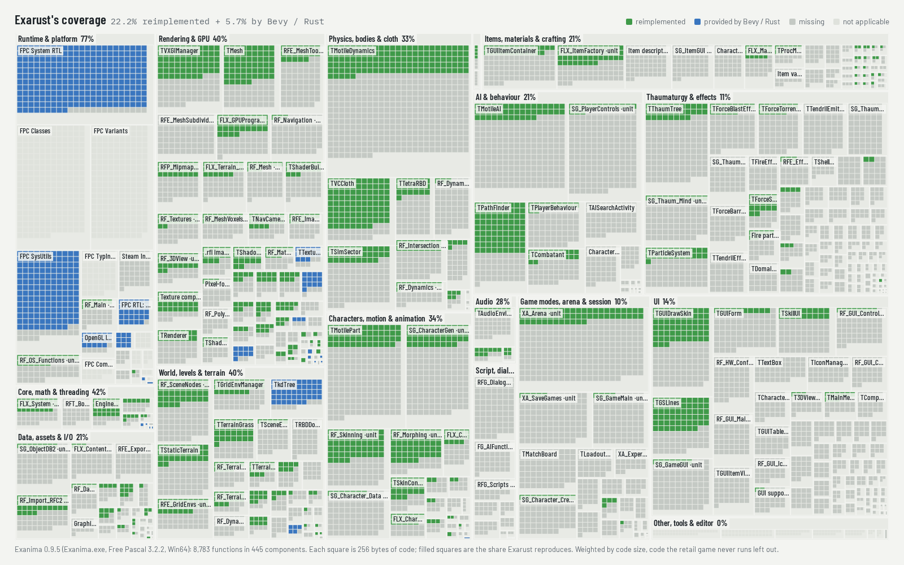

# Exarust

<picture>
  <source media="(prefers-color-scheme: dark)" srcset="docs/img/coverage-map-dark.png">
  
</picture>

*How much of the original game Exarust reproduces: every component of
`Exanima.exe`, grouped by section, filled green for the share Exarust's own
code reproduces and blue for what Bevy or Rust provide. Details and the
largest missing parts: [`docs/COMPONENT-MAP.md`](docs/COMPONENT-MAP.md).*

Exarust is an open-source reimplementation of the engine behind
[Exanima](https://store.steampowered.com/app/362490/Exanima/) by
[Bare Mettle Entertainment](https://www.baremettle.com/), written in Rust with [Bevy](https://bevy.org/) and wgpu.
Point it at a copy of Exanima you already own and it reads that
installation's packs (levels, models, textures, sounds) into its own engine.
The goal is a runtime that stays as close as possible to the original:
physically simulated characters, momentum-driven combat, layered armour,
procedural items, Story and Arena modes.

> **Status: early, walkable.** Levels load and render the way the original
> draws them, and a physically simulated character walks them with the
> original's controls and fights with its damage model. Menus, inventory,
> NPC behaviour, thaumaturgy, dialogue, saves and the Story and Arena modes
> are not there yet. See [`docs/PLAN.md`](docs/PLAN.md) for the roadmap.

## What works today

- **Data:** the installation's project file and all 12 `.rpk` packs; every
  texture format; meshes, materials, skeletons and motions; levels (tile grid,
  props, placed objects and characters, starts); terrain; races, the object
  database and weapon factories ([`docs/formats/`](docs/formats/README.md)).
- **World:** story levels and arenas assembled from their tile sets and
  terrain, with grass and plants, level lighting, an outdoor sky, and fires
  with their particles.
- **Rendering:** the original's shading programs, point lights that stop at
  walls with cube shadows cached as the original caches them, sun shadows,
  voxel global illumination, 4× supersampling, and the frame-rate readout in
  the game's font ([`docs/RENDERING.md`](docs/RENDERING.md)).
- **Bodies:** the original's body solver (each part a tetrahedron of four
  particles, stepped at 83 Hz), muscles that follow the animation, balance,
  falls and get-ups, and limp corpses.
- **Player:** the original's controls and chase camera, and a carried torch
  ([`docs/PLAYER.md`](docs/PLAYER.md)).
- **Combat:** weapons assembled by the game's factories, and blows resolved
  by the original's damage model with layered armour; a placeholder
  duellist.
- **Audio:** level music and ambience, impacts, footsteps.
- `exa-tool`, an inspector and extractor for the packs and formats.

## Build and run

You need Rust (rustup), GNU Make, the usual Bevy system libraries
([`docs/BUILD.md`](docs/BUILD.md)), and your own Exanima installation.

```bash
cp .env.example .env     # set EXANIMA_DIR to your Exanima folder
make info                # what's in the installation
make run                 # first light
cargo exa stats Objlib   # formats inside a pack
cargo run --release -p exarust -- play exanima01   # walk the first level
```

Exarust distributes no game assets and never modifies the installation.

## Layout

```
crates/
  exa_rpk        packs, project file, installation VFS          (implemented)
  exa_formats    format parsers: chunk trees, images, databases (most formats)
  exa_assets     Bevy bridge: models, skinning, textures, weapons (implemented)
  exa_world      levels: tile grids, sets, props, terrain, light (implemented)
  exa_render     materials, lighting, shadows, GI, post         (implemented)
  exa_anim       skeleton, motion clips, target poses           (started)
  exa_physics    body solver, level colliders; cloth to come    (started)
  exa_character  bodies, apparel, painting; morphs, injuries to come (started)
  exa_items      item DB, procedural materials                  (skeleton)
  exa_combat     weapon contacts, damage model, armour layers   (started)
  exa_ai         perception, navigation, combat AI              (placeholder)
  exa_audio      positional PCM, reverb, sound sets             (started)
  exa_script     dialogue, actors, journal                      (skeleton)
  exa_ui         menus, inventory, HUD, manual; game font, FPS  (started)
  exa_game       player control, balance, torch; modes to come  (started)
  exa_tool       `exa-tool` CLI
  exarust        the game binary
docs/            plan, architecture, formats, research
```

## Documentation

Development is spec-driven with [OpenSpec](https://openspec.dev/)
([workflow](docs/WORKFLOW.md)). Reverse engineering of the original
executable uses [REA](https://rea.tools/) with Ghidra
([tooling](docs/RE-TOOLING.md)).

- [Plan](docs/PLAN.md): phases, milestones, risks, next steps
- [Component map](docs/COMPONENT-MAP.md): every component of the original set
  against Exarust
- [Architecture](docs/ARCHITECTURE.md): crate layers, schedules, data flow
- [Debugging bodies](docs/DEBUGGING.md): the body overlay, joint readout and
  joint trace, and pausing, stepping and slowing the simulation
- [Formats](docs/formats/README.md): what is known about each retail format
- [Research](docs/INDEX.md): installation inventory, the engine's class map,
  community tools

## Acknowledgements and license

Inspired by [IW4L](https://github.com/vladtrc/iw4L), an open-source Bevy
runtime for Modern Warfare 2, whose layout and conventions this project
follows. Community reverse-engineering resources are credited in
[`docs/research/online-research.md`](docs/research/online-research.md).

Exarust's source is licensed under [Apache 2.0](LICENSE); see
[NOTICE](NOTICE). Exanima, its assets and trademarks belong to Bare Mettle
Entertainment. Exarust is not affiliated with them.
